<p align="center">
  <a href="https://www.linkedin.com/in/rodrigo-baraldi-costa-/"></a>
</p>

<p align="center">
  <a href="https://www.linkedin.com/in/rodrigo-baraldi-costa-/"></a>
  <a href="https://www.42sp.org.br/"></a>
  <a href="https://aws.amazon.com/certification/certified-cloud-practitioner/"></a>
</p>

## Olá, eu sou o Rodrigo 👋

Construo soluções com IA para problemas reais de negócio. Meu trabalho começa numa pergunta prática (o que está manual, lento ou pouco confiável?) e termina em algo que outra pessoa consegue usar: uma automação, uma ferramenta interna, um agente ou uma análise que sustenta uma decisão.

Uso IA generativa como ferramenta central de construção. O que me diferencia não é saber pedir código, é **especificar bem o problema** para a IA, com contexto, restrições e critérios de aceitação, e **validar o que ela entrega** antes de colocar em uso.

Em paralelo, estudo Engenharia de Software na **École 42 São Paulo** e Ciência da Computação na FMU. A 42 me dá a base que a IA não substitui: entender o que acontece por baixo, em C, sem bibliotecas prontas e sem professor dando a resposta.

## 🧠 Como eu construo com IA

```text
1. Entender     → qual decisão ou processo isso precisa melhorar?
2. Especificar  → contexto, arquivos de referência, restrições e critério de "pronto"
3. Construir    → Cursor, Claude, GPT, Gemini e Copilot como copilotos de engenharia
4. Validar      → testes, conferência de totais, simulação antes de produção
5. Entregar     → algo que outra pessoa usa sem precisar de mim do lado
```

## 🛠️ O que eu faço no dia a dia

Atuo com dados comerciais numa grande empresa do agronegócio. Os projetos são corporativos e o código não é público, mas o tipo de trabalho é este:

- **Dados confiáveis na nuvem:** pipelines que levam planilhas para o BigQuery em Python, preparados para orquestração com Apache Airflow.
- **Ferramentas internas com IA:** apps web, formulários guiados e rotinas que tiram o time das planilhas, com testes automatizados em Playwright.
- **Agentes:** especificação e bateria de testes para um agente de consulta a dados, com instruções que proíbem inventar informação e separam fato de hipótese.
- **Análise de dados com IA:** investigação de linhagem e qualidade de dados antes que virem indicador em dashboards de Power BI.

## 🚀 Projetos em destaque

| Projeto | O que é | Stack |
|---|---|---|
| [**Meu Frete**](https://baraldi97.github.io/meu-frete/) · [código](https://github.com/Baraldi97/meu-frete) | App offline para um caminhoneiro controlar viagens, diesel e despesas, construído com IA | PWA, JavaScript, IndexedDB |
| **Orquestração multimodelo** · *em breve* | Fluxo que envia a mesma tarefa para Claude, GPT e Gemini e compara as respostas | n8n, APIs de LLM |
| **Diário reflexivo com IA** · *em breve* | App que gera insights sobre as entradas, com memória semanal e mensal | Claude API, JavaScript |

## 🏫 École 42 São Paulo

Formação em Engenharia de Software baseada em projetos e avaliação entre pares, sem aulas e sem professores. Tudo em C, do zero.

| Projeto | O que aprendi |
|---|---|
| [**minishell**](https://github.com/Baraldi97/minishell) | Um shell inspirado no bash: lexer, parser, expansão de variáveis, pipes e redirecionamentos. Feito em dupla. |
| [**philosophers**](https://github.com/Baraldi97/philosophers) | Concorrência com threads e mutexes no clássico problema dos filósofos, evitando deadlocks e condições de corrida. |

## 🧰 Stack

**IA generativa**<br>
<a href="https://claude.ai"></a>
<a href="https://chatgpt.com"></a>
<a href="https://gemini.google.com"></a>
<a href="https://github.com/features/copilot"></a>
<a href="https://cursor.com"></a>
<a href="https://www.perplexity.ai"></a>

**Automação e integração**<br>
<a href="https://n8n.io"></a>
<a href="https://www.microsoft.com/power-platform/products/power-automate"></a>
<a href="https://www.microsoft.com/power-platform/products/power-apps"></a>
<a href="https://airflow.apache.org"></a>

**Dados e nuvem**<br>
<a href="https://cloud.google.com/bigquery"></a>
<a href="https://cloud.google.com"></a>
<a href="https://aws.amazon.com"></a>
<a href="https://www.microsoft.com/power-platform/products/power-bi"></a>
<a href="https://pt.wikipedia.org/wiki/SQL"></a>

**Desenvolvimento**<br>
<a href="https://www.python.org"></a>
<a href="https://pt.wikipedia.org/wiki/C_(linguagem_de_programa%C3%A7%C3%A3o)"></a>
<a href="https://developer.mozilla.org/pt-BR/docs/Web/JavaScript"></a>
<a href="https://developer.mozilla.org/pt-BR/docs/Web/HTML"></a>
<a href="https://flask.palletsprojects.com"></a>
<a href="https://playwright.dev"></a>

---

<p align="center"><i>Processo manual vira sistema. Dado bruto vira decisão.</i></p>
